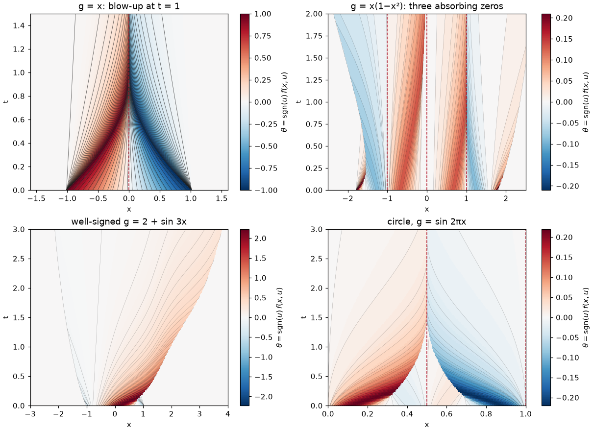

# Heterogeneous front tracking

This repository solves the heterogeneous scalar Cauchy problem

$$
u_t + \big(g(x)\,|u|^p\big)_x = 0,\qquad p>1,\qquad x\in\mathbb R \ \text{ or } \ x\in\mathbb R/L\mathbb Z,
$$

by front tracking. The default is $p=2$, the flux $g(x)u^2$. The derivative
of $g$ is discretised as a piecewise constant, so the flux becomes
**piecewise affine in $x$**. On every cell this makes the fronts and
characteristics explicit. In $\sigma=|g_\Delta|^{1-1/p}$ they are straight
lines; for $p=2$, $\sigma=\sqrt{|g_\Delta|}$ and in $x$ they are parabolas in
time. Every event time is the root of a *linear* equation, and no ODE solver
is used.

The work extends the heterogeneous front tracking of HetFT (Venkatesh, *Indian
J. Pure Appl. Math.*, 2026) and the *Failure of uniqueness* manuscript to
sign-changing $g$. There, zeros of $g$ are absorbing interfaces, $u$ can blow
up from bounded data, and front tracking selects the entropy solution that
satisfies the Lax-type interface condition.



## Standing assumptions

* **$h(u)=|u|^p$, $p>1$**, with $p=2$ the default and the case of HetFT and
  the manuscript. Set `MultiplicativeFlux(g, delta, power=p)`. The $p=2$
  path is the original quadratic code. For $p\ne2$ the front laws use one
  two-point mean in $\sigma=|g_\Delta|^{1-1/p}$
  ([derivation §3](docs/derivation.md#general-powers)).
  HetFT assumes a uniformly convex flux, which $|u|^p$ lacks globally
  when $p\ne2$. The discrete
  shock/fan rule follows instead from an exact conjugacy to homogeneous front
  tracking on each sign interval (§5). Convergence has been measured for
  $p=3/2,2,3$; these experiments do not prove a continuum limit.
* **Zeros of $g$ are transverse**, $|g'(z)|\ge\beta>0$ at every zero.
  `PiecewiseAffine.from_function` rejects detected tangential or numerically
  unresolved zeros ($x^2$, $x^3$, …). This is a sampling diagnostic, not a
  certificate that an arbitrary callable has no missed zeros. Resolve the
  coefficient's oscillations in the mesh and supply `dg` when available.
* **Well-signed $g$** ($|g|\ge g_{\min}>0$) is the **easier case**. There are
  no interfaces, $\theta$ is bounded and mass is conserved exactly, so it is
  HetFT front tracking proper. **Sign-changing $g$** adds absorbing interfaces
  at the zeros, unbounded but integrable $u$, and mass that can vanish into a
  zero or emerge from it.
* **Convergence** as $\delta,\Delta\to0$ is tested empirically only
  (`convergence.py`, notebook 07).

## The idea in five steps

The stationary profile is stated for general $p$; step 3 gives the quadratic
cell formula before its general-power extension.

1. $g'_\Delta$ is the cell average of $g'$, so $g_\Delta$ is the nodal
   interpolant. Detected zeros of $g$ are located and inserted as nodes.
2. The flux level $\theta = \mathrm{sgn}(u)f(x,u)$ is quantised,
   $\theta\in\delta\mathbb Z$. States between fronts are stationary profiles
   $u = \mathrm{sgn}(g)\,s(\theta)/|g_\Delta|^{1/p}$, where
   $s(\theta)=\mathrm{sgn}(\theta)|\theta|^{1/p}$, and
   $\mathrm{sgn}\,\theta$ is the direction of the characteristics.
3. On a cell with nonzero slope, $\sigma=\sqrt{|g_\Delta|}$ and $w=\sigma u$ turn the equation into
   Burgers: $w_t+\tfrac a2(w^2)_\sigma=0$. A front satisfies
   $\sigma(t)=\sigma_0+\tfrac12\alpha\kappa t$ with $\kappa=s(\theta_L)+s(\theta_R)$.
   On flat cells the fronts move at constant speed in $x$. For $|u|^p$,
   $\sigma=|g_\Delta|^{1-1/p}$ and $\sigma(t)=\sigma_0+(1-\tfrac1p)\alpha K t$, where $K$ is the
   secant slope of $|r|^p$ between $s(\theta_L)$ and $s(\theta_R)$.
4. Corners of $g_\Delta$ are passive: the front speed is continuous there, so no
   waves are emitted and only the closed-form law switches.
5. One Riemann rule serves both signs of $g$: a shock if $\theta_L>\theta_R$,
   a δ-fan if $\theta_L<\theta_R$, and no wave if they are equal.
   Zeros absorb arriving fronts in finite time, and the interface
   condition is $\theta(z^-)\ge0\ge\theta(z^+)$.

The full derivation, with the observed convergence orders, is in
[docs/derivation.md](docs/derivation.md).

## Notebooks

| Notebook | Contents |
| --- | --- |
| [01 · Playground](notebooks/01_playground.ipynb) | Your own $g$, δ, power $p$, mesh, data, line or circle; space–time plots, a time slider, snapshots, export |
| [02 · Ready-to-run examples](notebooks/02_ready_to_run_examples.ipynb) | xu² blow-up, the shock $-(t-2)^2/4$, three zeros, well-signed sine, two circle cases |
| [03 · Stationary profiles and the Riemann problem](notebooks/03_riemann_problem.ipynb) | Profiles $U[\theta]$, one θ-rule for both signs of $g$, δ-fans versus exact characteristics |
| [04 · Straightening and passive corners](notebooks/04_straightening_and_corners.ipynb) | Fronts straight in σ, closed form versus RK4, continuity at corners, no division by α, general powers $h=\lvert u\rvert^p$ |
| [05 · Interactions](notebooks/05_interactions.ipynb) | Event loop, Theorem 2.4 invariants, event statistics and cost, agreement with `fronttrack` |
| [06 · Zeros and non-uniqueness](notebooks/06_zeros_and_nonuniqueness.ipynb) | Absorption, blow-up, the selected solution versus the family $u_\lambda$, mass budget, interface layer |
| [07 · Convergence](notebooks/07_convergence.ipynb) | Empirical orders in δ and Δ, selectable power, line and circle; recorded general-power studies |
| [08 · The circle](notebooks/08_circle.ipynb) | Wraparound, exact mass, signed effective flux, exact spatial conjugacy, stationary corrector bound, resolution-controlled homogenisation experiments, sign arcs |

Notebooks 01 and 02 include the solver and can run independently in Jupyter
or Colab. Notebooks 03–08 require this repository and its installed dependencies.
For a private repository, authenticate when cloning it before opening these
notebooks; an unauthenticated Colab session cannot fetch the package. Regenerate the
notebooks with `python tools/build_notebooks.py`, then execute them with
`python tools/check_notebooks.py --write`.

## Get started

Use Python 3.10 or newer. From the repository root, install the package and
notebook dependencies:

```bash
python -m pip install -e ".[notebook]"
python -m unittest discover -s tests -t . -v
python main.py --list
python main.py --example xu2-blowup
python main.py --example two-zeros --power 1.5
python convergence.py
python convergence.py --power 1.5 --power 3 --max-events 5000000
```

`main.py --example NAME` writes the following to `results/`:

- `NAME.png`: $g_\Delta$, θ in space–time with exact fronts, the final u profile, and diagnostics;
- `NAME.npz`: sampled levels, θ and u;
- `NAME_pieces.csv`: every closed-form front piece;
- `NAME_diagnostics.csv`: front count, TV(θ), mass, absorbed mass and edge inflow.

Options: `--delta`, `--nodes`, `--cells`, `--power`, `--time`,
`--interface-layer`, `--frames`, `--samples`, `--max-events`, `--output`,
`--no-plot`. The examples are `sine`, `burgers`, `xu2-shock`, `xu2-blowup`,
`two-zeros`, `power-sine` ($p=3$), `power-zeros` ($p=3/2$), `circle-sine`,
`circle-zeros` and `circle-homogenisation`. `--power` overrides an example's
$p$; the xu² examples are exact solutions only for $p=2$.

`explore.py` is a small editable script that opens a figure.

## API

```python
import numpy as np
from hetfront import PiecewiseAffine, MultiplicativeFlux, HeteroFrontTracker, PeriodicHeteroFrontTracker
from hetfront.visualization import observe_tracker, overview

g = PiecewiseAffine.from_function(lambda x: x * (1 - x**2), np.linspace(-2, 2, 41))  # zeros become nodes
flux = MultiplicativeFlux(g, delta=0.01)                                             # θ ∈ δZ, h = u²
# MultiplicativeFlux(g, delta=0.01, power=3) gives h(u) = |u|³
tracker = HeteroFrontTracker.from_function(flux, lambda x: np.cos(2 * x), window=(-1.5, 1.5), cells=90)
history = observe_tracker(tracker, np.linspace(-2.5, 2.5, 801), np.linspace(0, 2, 121))
overview(history)

tracker.counts             # collisions, corners, absorptions, emissions
tracker.integral(-3, 3)    # exact ∫u (cell-wise closed form, finite at zeros)
tracker.mass_absorbed()    # net mass that has gone into the zeros
tracker.flux_through(0.5, [0, 1, 2])  # exact ∫ f(0.5, u(0.5, t)) dt from t = 0 (line; needs history)
xs = np.linspace(-3, 3, 601)
tracker.primitive(xs)      # exact running integral of u from xs[0]
```

Initial data can also be given directly as levels:
`HeteroFrontTracker(flux, positions, levels)`, or
`HeteroFrontTracker.from_theta(flux, positions, theta_values)`.

On the circle, use `PiecewiseAffine.from_function(g, nodes, period=L)` and
`PeriodicHeteroFrontTracker`; N breakpoints take N levels.

Two options handle zeros of $g$:

- `interface_layer=ε` sets θ = 0 near each zero, as in the manuscript.
- `enforce_interface=False` disables selection. Suitable data approximate the
  *non-selected* solutions in the manuscript's unbounded entropy-inequality
  class. Arbitrary traces need not be entropy-admissible: check
  `tracker.interface_entropy_admissible()` ($\theta_L\ge\theta_R$ at zeros).
  This class does not separately impose the weak conservation law.

## Implementation notes

* Fronts carry an anchor $(t_0,x_0,\sigma_0)$, so positions are evaluated in
  closed form and never time-stepped. Events wait in a heap with lazy
  invalidation.
* The θ-L¹ distance, primitive values, and profile integrals use closed forms
  (up to floating-point roundoff), including across multiple circle periods.
  `u_l1_distance` is exact for trackers sharing the same heterogeneity object.
  A maximum of primitive values on a grid is a sampled maximum, not a certified
  continuum supremum. The boundary inflow in plot diagnostics is exact:
  `tracker.flux_through(x, times)` integrates $f(x,u(x,t))$ over the
  closed-form crossing times of the recorded fronts, independently of $\int u$,
  so the mass budget is a genuine check.
* The tests cover the following:
  - closed form against RK4 across many corners, for $p=2$ and $p\in\{3/2,3\}$;
  - the manuscript's exact xu² solutions;
  - non-increasing TV and front count;
  - exact mass budgets, including absorbed mass and fronts crossing the window edges;
  - L¹ contraction;
  - tangential-zero rejection;
  - a full-circle triple collision;
  - for $p\ne2$, the exact solution $x(t)=(1-qt)^{m}$ into a zero, the
    physical Rankine–Hugoniot speed, and exact conjugacy with the effective
    flux $\eta\langle|g|^{-1/p}\rangle^{-p}|v|^p$ on the circle.
* Optional reference-solver tests compare the constant-coefficient case with
  `fronttrack` on the line (for $u^2$ and $|u|^p$) and `fronttrack.periodic` on the circle. They are skipped
  when those packages are unavailable; neither is a runtime dependency.

## Convergence experiments

`convergence.py` accepts repeated `--power` values, `--problem`, `--levels`,
`--depth` (extra reference refinements), `--samples` (primitive grid), and
`--max-events` (per-run event limit). The default exponent remains $p=2$.
Each study separates flux-level, coefficient-mesh, and joint refinement.
CSV rows include the exponent; companion JSON files preserve reference settings
and costs. Nonquadratic filenames include the power, so different powers do
not overwrite one another. Use separate `--output` directories for comparisons
of reference depth or sampling density.

[The general-power convergence report](docs/convergence-2026-10-15.md) records
five-level experiments for $p=3/2,3$ on all four line/circle and
well-signed/sign-changing problems, with finer spatial-reference and sampling
checks. The data and plots are numerical evidence, not convergence theorems.
Initial theta data are held fixed across powers; their physical $u$ profiles
therefore vary with $p$.

## Audit and maintenance

The current baseline passes **92 unit/regression tests** and **420 deterministic
randomized cases** (2026-10-15); the largest randomized mass-budget residual
was $3.62\times10^{-10}$.

See [the audit report](docs/audit-2026-10-09.md) for reproduced defects,
the theory verdict, verification evidence, and remaining scope limits.
[The derivation](docs/derivation.md#9-homogenisation-and-the-exact-coordinate-map)
explains why homogenisation must use the effective coefficient of the actual
interpolant. `tools/build_notebooks.py` is the notebook source of truth;
regenerate bundled source after package edits and execute all notebooks before
committing. Cell IDs are deterministic so diffs expose substantive changes.
