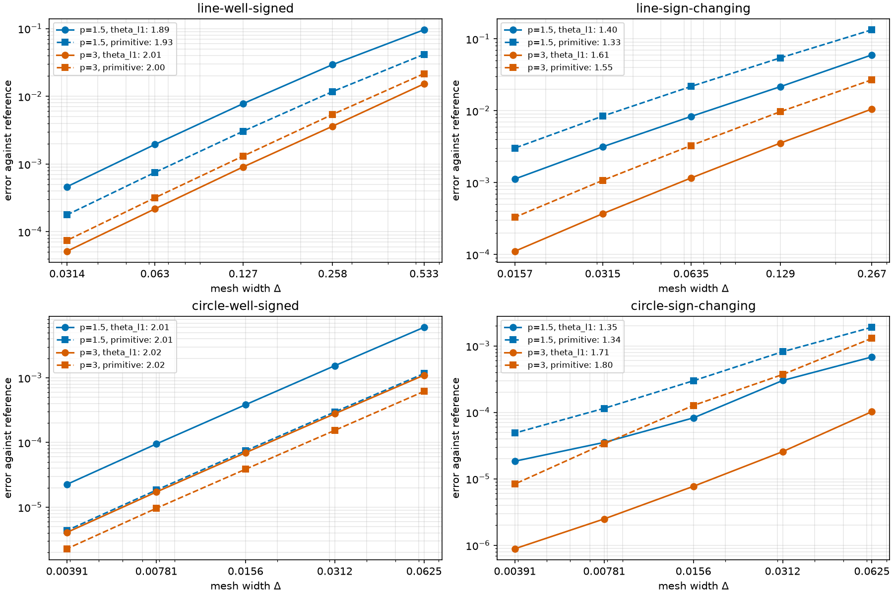

# General-power convergence — 2026-10-15

Five-level refinement studies now cover $p=3/2,3$ on the line and circle,
with well-signed and sign-changing coefficients. These measurements compare
front approximations against numerical references; they do not establish
a continuum limit, an interface-layer limit, or a universal convergence rate.

## Experiment and measurements

All runs use the four initial-value problems in [studies.py](../src/hetfront/studies.py)
at $t=1$. Initial theta values are multiples of $0.1$ and are represented exactly
on every tested flux lattice. They are held fixed across powers, so the physical
initial profiles change with $p$. These are refinement comparisons for each
equation, not comparisons of different equations with identical physical data.

- Flux spacings: $\delta=0.1,0.05,0.025,0.0125,0.00625$.
- Coefficient node counts: $16,32,64,128,256$ before zero insertion.
- Baseline reference: $\delta_{\mathrm{ref}}=0.0015625$, 1024 coefficient nodes.
- Delta-only runs hold the coefficient mesh at reference resolution; mesh-only
  runs hold delta at reference resolution. Joint runs refine both.
- Mesh width is the original grid spacing: span/(nodes−1) on the line, period/nodes
  on the circle; inserted zero nodes can shorten individual cells.
- Theta-L1 is integrated exactly up to roundoff. Primitive error is a maximum
  of exact primitive values at 801 equally spaced points, not a certified supremum.
- Orders are least-squares fits across all five levels.

## Baseline fitted orders

Each entry is theta-L1 order, followed by primitive order in parentheses.

| $p$ | Problem | Delta only | Mesh only | Joint |
| --- | --- | --- | --- | --- |
| 1.5 | line-well-signed | 1.04 (1.01) | 1.89 (1.93) | 1.16 (1.40) |
| 1.5 | line-sign-changing | 0.94 (1.00) | 1.40 (1.33) | 1.15 (1.28) |
| 1.5 | circle-well-signed | 1.02 (1.94) | 2.01 (2.01) | 1.04 (2.04) |
| 1.5 | circle-sign-changing | 0.93 (0.94) | 1.35 (1.34) | 0.93 (0.97) |
| 3 | line-well-signed | 1.04 (1.03) | 2.01 (2.00) | 1.04 (1.17) |
| 3 | line-sign-changing | 1.05 (1.05) | 1.61 (1.55) | 1.05 (1.12) |
| 3 | circle-well-signed | 0.99 (2.12) | 2.02 (2.02) | 1.01 (2.08) |
| 3 | circle-sign-changing | 1.04 (0.90) | 1.71 (1.80) | 1.04 (0.90) |



## Finer reference and sampling checks

The spatial reference is recomputed with 2048 nodes, holding
$\delta_{\mathrm{ref}}=0.0015625$ fixed. Every mesh-only run is then compared
against that reference on 801 and 1601 nested primitive sample points.
This isolates spatial-reference sensitivity without introducing a different
flux discretisation into the mesh comparison. Delta-only and joint reference
sensitivity are not assessed by this check.

| $p$ | Problem | Theta: baseline → finer reference | Primitive: baseline → finer reference | Primitive: finer reference, 1601 samples |
| --- | --- | --- | --- | --- |
| 1.5 | line-well-signed | 1.89 → 1.88 | 1.93 → 1.91 | 1.91 |
| 1.5 | line-sign-changing | 1.40 → 1.36 | 1.33 → 1.30 | 1.30 |
| 1.5 | circle-well-signed | 2.01 → 2.00 | 2.01 → 2.00 | 2.00 |
| 1.5 | circle-sign-changing | 1.35 → 1.27 | 1.34 → 1.28 | 1.29 |
| 3 | line-well-signed | 2.01 → 1.99 | 2.00 → 1.99 | 1.99 |
| 3 | line-sign-changing | 1.61 → 1.58 | 1.55 → 1.53 | 1.53 |
| 3 | circle-well-signed | 2.02 → 2.00 | 2.02 → 2.00 | 2.00 |
| 3 | circle-sign-changing | 1.71 → 1.66 | 1.80 → 1.78 | 1.78 |

Doubling primitive sampling changes a fitted mesh order by at most 0.013
and an individual sampled primitive error by at most 13.06% in these checks.
This is a sampling sensitivity measurement, not a bound on the continuum supremum.

## Interpretation

The well-signed runs are close to second order in coefficient mesh, while
flux-level theta errors are roughly first order. Primitive errors can behave
differently: the primitive integrates signed errors and can exhibit cancellation.
In the well-signed circle examples its observed delta order is higher than
the theta-L1 order.

Near zeros, the local profile argument suggests $\Delta^{2-1/p}$, giving
$4/3$ for $p=3/2$ and $5/3$ for $p=3$. It is not a dynamic error estimate.
The sign-changing measured slopes vary with the problem, metric, and reference;
in particular, the $p=3/2$ circle theta mesh fit changes from about 1.35 to
1.27 with a finer reference. These experiments support refinement convergence
over the tested range, but do not establish either proposed exponent.

The primitive errors are not monotone at the coarsest circle sign-changing
levels. Under delta-only refinement, the first two errors are 0.00983 → 0.01210
for $p=3/2$ and 0.02461 → 0.02623 for $p=3$, before falling on the remaining
levels to 0.000954 and 0.00234 respectively. Joint refinement has the same
initial increase. A fitted order summarises this range; it does not guarantee
an error reduction at every refinement step.

## Reproduction and saved evidence

From the repository root:

```bash
python convergence.py --power 1.5 --power 3 --levels 5 --depth 2 --no-plot --max-events 5000000 --output docs/data/convergence-2026-10-15
python tools/check_mesh_reference.py docs/data/convergence-2026-10-15 --power 1.5 --output docs/data/convergence-2026-10-15/checks/p1p5.json
python tools/check_mesh_reference.py docs/data/convergence-2026-10-15 --power 3 --output docs/data/convergence-2026-10-15/checks/p3.json
```

The raised event limit allows the finer circle references to finish; it changes
only the stopping guard, not the discretisation. Use a separate output directory
for altered settings. Omitting `--no-plot` also writes the full refinement plot.

[Saved CSV and JSON records](data/convergence-2026-10-15/) contain all 120
baseline error rows, eight baseline references, eight finer spatial references,
and 40 mesh-check rows. JSON includes measured event counts and run times.
[Notebook 07](../notebooks/07_convergence.ipynb) exposes the power setting and
plots the checked-in general-power mesh results.

Validation: 92 unit/regression tests passed, including analytic physical shock
speeds for three exponents, multi-power CLI exports, resolution validation, and
nested primitive sampling. All eight notebooks were executed with saved outputs.
The pre-existing 420-case stress baseline also passed during this session.
No solver front laws were changed in this stage.
