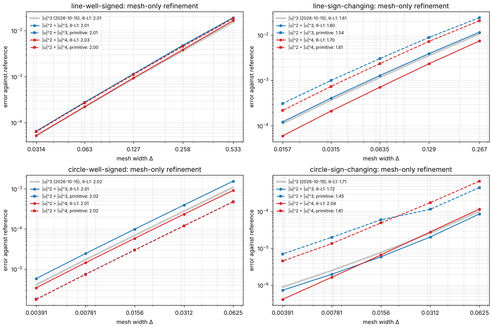

# General-flux convergence — 2026-11-05

Five-level refinement studies for two general convex nonlinearities,
$h=u^2+u^4$ and $h=u^2+|u|^3$, on the same four problems as the power-law
studies. These measurements compare front approximations with numerical
references. They do not establish a continuum limit or a universal rate.

For a general $h$ no coordinate straightens the fronts
([derivation §3b](derivation.md#3b-general-convex-h)). Event times are closed-form
arrival times and monotone roots, solved by Newton with the exact derivative.
Both nonlinearities are uniformly convex ($h''\ge2$), which $|u|^p$ is not for $p\ne2$.

## Experiment and measurements

The settings are those of [the general-power report](convergence-2026-10-15.md),
unchanged:

- **Initial data:** the four problems of [studies.py](../src/hetfront/studies.py), at $t=1$. Initial theta values are multiples of $0.1$, held fixed across nonlinearities, so the physical profiles differ between $h$.
- **Flux spacings:** $\delta=0.1,\dots,0.00625$.
- **Coefficient nodes:** $16,\dots,256$.
- **Reference:** $\delta_{\mathrm{ref}}=0.0015625$ with 1024 nodes, two halvings beyond the finest run.
- **Refinements:** δ-only runs hold the mesh at reference resolution, mesh-only runs hold δ there, and joint runs refine both.
- **Metrics:**
  - θ-L¹ is exact up to roundoff.
  - The primitive error is a maximum of exact primitive values at 801 points, not a certified supremum.
  - Primitive values use the closed-form cell masses of the general profiles, $P(\theta,\gamma)=\gamma Q(H(\theta/\gamma))$.

## Fitted orders

Each entry is the θ-L¹ order, with the primitive order in parentheses.
The orders are least-squares fits over all five levels.

| $h$ | Problem | δ only | Mesh only | Joint |
| --- | --- | --- | --- | --- |
| $u^2+u^4$ | line-well-signed | 1.01 (1.02) | 2.03 (2.00) | 1.03 (1.19) |
| $u^2+u^4$ | line-sign-changing | 1.04 (0.99) | 1.70 (1.61) | 1.04 (1.12) |
| $u^2+u^4$ | circle-well-signed | 0.98 (2.07) | 2.01 (2.02) | 0.99 (1.93) |
| $u^2+u^4$ | circle-sign-changing | 0.97 (0.88) | 2.04 (1.81) | 0.98 (0.88) |
| $u^2+\lvert u\rvert^3$ | line-well-signed | 1.03 (1.03) | 2.01 (2.01) | 1.06 (1.20) |
| $u^2+\lvert u\rvert^3$ | line-sign-changing | 1.03 (1.04) | 1.60 (1.54) | 1.03 (1.16) |
| $u^2+\lvert u\rvert^3$ | circle-well-signed | 1.00 (1.96) | 2.01 (2.02) | 1.00 (1.92) |
| $u^2+\lvert u\rvert^3$ | circle-sign-changing | 0.97 (0.84) | 1.72 (1.45) | 0.97 (0.84) |



## Near zeros the top degree governs

The local profile heuristic of the derivation (§8) gives $\Delta^{2-1/k}$ beside a
zero, where $k$ is the exponent that governs $U$ there. For a polynomial that is
the top degree: $7/4$ for $u^2+u^4$ and $5/3$ for $u^2+|u|^3$. Level-by-level mesh
slopes of θ-L¹ on the sign-changing problems compare as follows:

| Problem | $h$ | Local slopes, coarse → fine | Fitted |
| --- | --- | --- | --- |
| line | $\lvert u\rvert^3$ (2026-10-15) | 1.50, 1.58, 1.63, 1.73 | 1.61 |
| line | $u^2+\lvert u\rvert^3$ | 1.50, 1.57, 1.63, 1.73 | 1.60 |
| line | $u^2+u^4$ | 1.60, 1.68, 1.72, 1.81 | 1.70 |
| circle | $\lvert u\rvert^3$ (2026-10-15) | 2.00, 1.73, 1.63, 1.49 | 1.71 |
| circle | $u^2+\lvert u\rvert^3$ | 2.08, 1.79, 1.58, 1.45 | 1.72 |
| circle | $u^2+u^4$ | 2.07, 2.08, 2.02, 2.00 | 2.04 |

On the line, $u^2+|u|^3$ and $|u|^3$ agree to the second decimal at every level,
despite different flux near $u=0$. That is direct evidence that the top degree
sets the near-zero error. The quartic-top flux is steeper throughout, and on the
line the ordering $u^2$ (1.46), $|u|^3$ (1.61), $u^2+|u|^3$ (1.60), $u^2+u^4$ (1.70)
follows $2-1/k_{\max}$. Two cautions apply:

* **The line slopes rise toward the finest level, past the heuristic** (1.81 > 7/4,
  1.73 > 5/3). The reference is only four times finer than the finest run.
  Subtracting a fixed reference makes the finest levels steeper. The
  finer-reference check below confirms this: the finest slopes become 1.74
  and 1.65.
* **On the circle, $u^2+u^4$ stays at a flat 2.0.** Its errors there are 30–100 times
  smaller than on the line. By $t=1$ the polynomial dynamics leave weak
  interface levels beside the zeros: about $(8,-1)$ and $(3,0)$ at δ = 0.0125,
  against $(16,-2)$ for $u^2$. They also absorb about six times less mass. The
  singular near-zero term scales with those levels, and for $k=4$ its rate
  $\Delta^{7/4}$ is close to $\Delta^2$. So the smooth second-order error dominates
  the whole tested range. The cubic-top fluxes show the turn from 2 towards the
  near-zero rate within the same range. We read the 2.04 as pre-asymptotic, not
  as a contradiction of the heuristic.

Away from zeros (well-signed $g$) all mesh orders are $2.01$–$2.03$ and all δ
orders $0.98$–$1.03$, as for powers. On the well-signed circle the primitive's δ
order is near 2, as it was for powers: the signed errors cancel.

## Finer reference check

The spatial reference is recomputed with 2048 nodes, holding
$\delta_{\mathrm{ref}}=0.0015625$ fixed. Every mesh-only run is compared with it on
801 and 1601 nested primitive samples. The circle-well-signed studies are not
rechecked: their mesh orders are 2.01 for both nonlinearities and metrics, as
for powers.

| $h$ | Problem | θ-L¹: baseline → finer | Primitive: baseline → finer | Primitive, 1601 samples |
| --- | --- | --- | --- | --- |
| $u^2+u^4$ | line-well-signed | 2.03 → 2.01 | 2.00 → 1.98 | 1.98 |
| $u^2+u^4$ | line-sign-changing | 1.70 → 1.68 | 1.61 → 1.59 | 1.59 |
| $u^2+u^4$ | circle-sign-changing | 2.04 → 2.02 | 1.81 → 1.77 | 1.77 |
| $u^2+\lvert u\rvert^3$ | line-well-signed | 2.01 → 1.99 | 2.01 → 1.99 | 1.99 |
| $u^2+\lvert u\rvert^3$ | line-sign-changing | 1.60 → 1.58 | 1.54 → 1.52 | 1.52 |
| $u^2+\lvert u\rvert^3$ | circle-sign-changing | 1.72 → 1.67 | 1.45 → 1.41 | 1.41 |

Doubling the primitive sampling changes no individual error by more than 0.1%.
The level-by-level θ-L¹ slopes show what the finer reference changes:

| Problem | $h$ | 1024-node reference | 2048-node reference |
| --- | --- | --- | --- |
| line | $u^2+u^4$ | 1.60, 1.68, 1.72, 1.81 | 1.60, 1.68, 1.70, 1.74 |
| line | $u^2+\lvert u\rvert^3$ | 1.50, 1.57, 1.63, 1.73 | 1.49, 1.57, 1.61, 1.65 |
| circle | $u^2+u^4$ | 2.07, 2.08, 2.02, 2.00 | 2.07, 2.08, 2.00, 1.92 |
| circle | $u^2+\lvert u\rvert^3$ | 2.08, 1.79, 1.58, 1.45 | 2.08, 1.77, 1.52, 1.33 |

* **Line.** The overshoot past the heuristic came from the reference. With the
  finer one, the slopes rise toward $7/4$ (1.74) and $5/3$ (1.65) from below.
  Their fitted orders are 1.68 and 1.58.
* **Circle, $u^2+u^4$.** The finest slope now turns down (1.92). That fits the
  reading above: the near-zero term begins to show only at the finest levels.
* **Circle, $u^2+|u|^3$.** The slopes fall below $5/3$ and fall further with the
  finer reference. The recorded $|u|^3$ run on this problem does the same
  (1.49 at the finest level). The cause is the position of the zeros within
  their cells, not δ; see the next section.

The heuristic $\Delta^{2-1/k_{\max}}$ is therefore consistent with the line
measurements, but no measurement here establishes it.

## Zero alignment and the circle slopes

Two hypotheses for the falling circle slopes were tested on the fast $|u|^3$
path ([data](data/convergence-2026-11-05/delta-floor/), `tools/check_delta_floor.py`).

**A fixed-δ floor is ruled out.** The mesh-only runs of circle-sign-changing
were repeated at a quarter and a sixteenth of the flux spacing, each against
a reference with that same δ. At δ/4 the errors agree with the baseline to 0.3%
at every level. At δ/16 they are 0.3–2% lower. Neither shifts the local slopes
by more than 0.01:

| $h$ | δ | Mesh errors (θ-L¹) | Local slopes |
| --- | --- | --- | --- |
| $\lvert u\rvert^3$ | 0.0015625 | 1.03e-4, 2.57e-5, 7.71e-6, 2.49e-6, 8.88e-7 | 2.00, 1.73, 1.63, 1.49 |
| $\lvert u\rvert^3$ | 0.000390625 | 1.03e-4, 2.57e-5, 7.73e-6, 2.50e-6, 8.90e-7 | 2.00, 1.73, 1.63, 1.49 |
| $\lvert u\rvert^3$ | 0.00009765625 | 1.02e-4, 2.53e-5, 7.56e-6, 2.45e-6, 8.72e-7 | 2.01, 1.74, 1.63, 1.49 |
| $u^2+\lvert u\rvert^3$ | 0.0015625 | as in the study | 2.08, 1.79, 1.58, 1.45 |

The $u^2+\lvert u\rvert^3$ run at δ/4 was stopped after two hours, unfinished.
The general-h path costs about 13 times as much per event, and the $\lvert u\rvert^3$
result already settles the question.

**The zeros' position within their cells is the cause.** Zeros are inserted as
nodes, splitting their cell at a fraction $f$. Under dyadic refinement $f$ stays
fixed only for a dyadic zero:

* **line problems:** $f=(0.75,0.5,0.25)$ at every level, which is why the line slopes are clean;
* **circle-sign-changing,** with zeros at $0.5485$ and $0.9515$: $f$ wanders, $0.22\to0.45\to0.90\to0.79\to0.59$.

A clean test needs one coefficient with $g''\ne0$ at its zeros, run aligned
and translated. $g=\sin2\pi x$ has $g''=0$ at its zeros, so it is unsuitable
(its slopes are about 2.06 for a different reason). The test therefore uses
$g=\sin2\pi x\,(1+0.3\sin2\pi x)$, with zeros at $0$ and $\tfrac12$ and $g''=\pm0.6(2\pi)^2$ there. It
was run once as is, with the zeros on nodes at every level, and once translated
by $0.1137$, with the initial data translated identically. The two runs solve
the same problem: their reference interface levels are identical, $(33,0)$ and
$(63,-20)$.

| Zeros | Fractions $f$ by level | Local slopes | Fitted |
| --- | --- | --- | --- |
| on nodes | 0, 0, 0, 0, 0 | 1.19, 1.41, 1.54, 1.67 | 1.46 |
| shifted by 0.1137 | 0.82, 0.64, 0.28, 0.55, 0.11 | 1.92, 0.60, 1.97, 0.81 | 1.32 |

Aligned, the slopes rise monotonically toward $5/3$, as on the line. Misaligned,
they swing between 0.6 and 2.0. The circle anomalies of this report and of
the 2026-10-15 report are therefore measurement artefacts of misaligned
zeros. A fitted order on such meshes summarises the fluctuation and is not an
asymptotic rate. Studies of near-zero rates should place the zeros on dyadic
nodes, or refine by factors that keep $f$ fixed.

## Cost

At these resolutions an event costs about 1 ms. The quartic and cubic
references took 0.95–1.42 ms per event: 200–830 thousand events and 220–820 s
each. That is roughly 13 times the 0.08 ms per event of the recorded power-law
runs, which use the straight-line formulas. All eight studies ran in 45 minutes,
four at a time on four cores.

## Reproduction and saved evidence

From the repository root:

```bash
python convergence.py --flux "u^2+u^4" --flux "u^2+|u|^3" --levels 5 --depth 2 --no-plot \
    --max-events 5000000 --output docs/data/convergence-2026-11-05
python tools/normalise_flux_records.py docs/data/convergence-2026-11-05
P="--problem line-well-signed --problem line-sign-changing --problem circle-sign-changing"
python tools/check_mesh_reference.py docs/data/convergence-2026-11-05 --flux "u^2+u^4" $P \
    --output docs/data/convergence-2026-11-05/checks/u2+u4.json
python tools/check_mesh_reference.py docs/data/convergence-2026-11-05 --flux "u^2+|u|^3" $P \
    --output docs/data/convergence-2026-11-05/checks/u2+u3.json
python tools/plot_flux_convergence.py docs/data/convergence-2026-11-05 docs/convergence-2026-11-05.png
```

The studies were run one problem and flux per process, four at a time. Their
stdout logs are in `logs/`. Four line records were written before a metadata fix:
they recorded the nonlinearity under `h` and `power` as the default 2.0.
`tools/normalise_flux_records.py` rewrote them to the current layout (`flux`
label, `power: null`) and regenerated their CSVs. No measured value changed; this
was checked against a copy. In every row, `h` is the mesh width.

The general-h root solver was tightened after these studies were run. Its Newton
stopping test became relative to the distance to the nearest zero, not to $|x|$.
This fixed a $10^{-7}$ mass residual found by the stress check, in fronts within
$10^{-6}$ of a zero. The old and new solvers were run on a study configuration
and gave identical output, so the recorded data stands.

[Saved CSV and JSON records](data/convergence-2026-11-05/) contain 120 error rows,
eight references, six finer spatial references and 30 mesh-check rows (`checks/`). [Notebook 07](../notebooks/07_convergence.ipynb) plots the
recorded δ-only and mesh-only errors.

Validation:
- 134 unit and regression tests pass, 5 optional `fronttrack` oracle tests are skipped, and all eight notebooks execute with saved outputs. The studies were recorded at 121 tests; the rest came with asymmetric $h$.
- The stress check passes: 420 power-law cases with an unchanged worst mass residual of $3.62\times10^{-10}$, and 300 general-h cases (60 of them asymmetric reflection checks) at $1.91\times10^{-10}$.
- Power-law runs are bit-identical to the 2026-10-15 baseline on every example.
