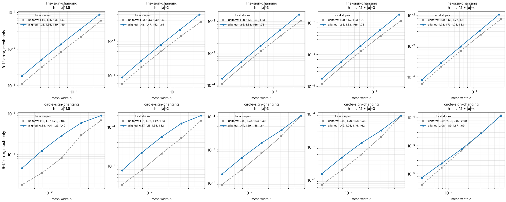

# Convergence on zero-aligned meshes (2026-11-06)

The [general-flux report](convergence-2026-11-05.md#zero-alignment-and-the-circle-slopes)
traced the erratic mesh slopes on the sign-changing circle to the zeros of $g$
moving inside their cells from one level to the next. This report repeats the
mesh-only studies of both sign-changing problems on **zero-aligned meshes**,
now the default (`PiecewiseAffine.aligned`).

The findings in brief:

* **On the line the rate is now measurable to two digits.** Correcting for the
  finite reference, the mesh order is $2-1/k_{\max}$ to within 0.04 for all
  five nonlinearities. $k_{\max}$ is the top degree of $h$.
* **On the circle the slopes now rise steadily** instead of swinging. At 1024
  cells they are 0.04–0.08 below the same prediction and still rising.
* **Alignment makes the rate legible; it does not make the solution more
  accurate.** At equal cell counts the aligned errors are 1.3–1.6 times the
  uniform ones on the line, and 2–3.5 times on the circle at the finest levels.

All rates here are observations against numerical references, not theorems.



## Aligned meshes

A uniform mesh with each zero inserted as a node splits that zero's cell at a
fraction $f$. Under dyadic refinement $f$ stays fixed only when the zero sits at
a dyadic position relative to the mesh. An aligned mesh instead makes every zero
a node and divides each arc between zeros (or between a zero and an end of the
interval) into equal cells.

* **Cell counts.** The counts are shared out in proportion to arc length, at the
  coarsest level reached by halving while each arc keeps about four cells on
  average. They are then doubled back up. So every finer level bisects every
  arc, and each zero keeps the same neighbourhood in mesh units.
* **When nothing changes.** Where the uniform mesh already has this property,
  `aligned` returns it unchanged. That holds for every listed example at its
  default resolution, so their outputs are unchanged.
* **Resolution on the line.** An aligned study mesh at resolution $n$ has $n$
  cells; the earlier uniform meshes had $n$ nodes, so $n-1$ cells. For
  `line-sign-changing` (zeros at $-1,0,1$ on $[-2,2]$) the aligned meshes are
  uniform with $h=4/n$ and the zeros on nodes.
* **On the circle.** The chart starts at the first node after the origin. The
  periodic tracker now wraps positions given in any window of one period into
  its chart.

## Line: the order equals $2-1/k_{\max}$ once the reference is accounted for

The finest local slopes on the line overshoot $2-1/k_{\max}$ by a nearly fixed
amount. That amount is what a reference only four times finer predicts. Suppose
run and reference have mesh errors of the same sign, $e(h)\approx Ch^r$. Then the
measured difference is

$$\tilde e(h) = C\,(h^r - h_{\mathrm{ref}}^r),\qquad h_{\mathrm{ref}} = h_{\min}/4 .$$

At the finest level this steepens the local slope by
$\log_2\frac{1-8^{-r}}{1-4^{-r}}$: $+0.15$ for $r=4/3$, $+0.13$ for $r=3/2$,
$+0.10$ for $r=5/3$. `tools/fit_reference_order.py` fits $r$ and $C$ to this
model by least squares in $\log\tilde e$:

| $h$ | Predicted $2-1/k_{\max}$ | Aligned local slopes | Plain fit | Corrected fit | RMS log residual |
| --- | --- | --- | --- | --- | --- |
| $\lvert u\rvert^{3/2}$ | 1.333 | 1.35, 1.36, 1.39, 1.49 | 1.39 | **1.34** | 0.001 |
| $u^2$ | 1.5 | 1.46, 1.47, 1.52, 1.61 | 1.51 | **1.47** | 0.005 |
| $\lvert u\rvert^3$ | 1.667 | 1.63, 1.63, 1.66, 1.75 | 1.66 | **1.63** | 0.003 |
| $u^2+\lvert u\rvert^3$ | 1.667 | 1.63, 1.63, 1.66, 1.75 | 1.66 | **1.63** | 0.004 |
| $u^2+u^4$ | 1.75 | 1.73, 1.73, 1.75, 1.83 | 1.76 | **1.72** | 0.002 |

* **The model fits closely.** A two-parameter model fits five levels with
  residuals of 0.1–0.5%. The corrected orders are within 0.04 of the
  prediction: one is 0.01 above it, the rest up to 0.04 below.
* **The top degree sets the rate.** $u^2+|u|^3$ reproduces $|u|^3$ slope for
  slope, as on uniform meshes.
* **The uniform line studies carry the same correction.** Their corrected orders
  are 1.34, 1.41, 1.57, 1.57 and 1.67 in the order of the table. The residuals are
  larger (0.01–0.03), because each zero's fixed but unequal split adds a second
  length scale.

This is stronger support for the local heuristic of
[§8](derivation.md#8-observed-convergence) than any earlier measurement. It
remains an observation: the heuristic integrates an interpolation error over one
cell and ignores the dynamics.

## Circle: monotone approach, still pre-asymptotic

Local slopes of the mesh-only θ-L¹ error on `circle-sign-changing`
(zeros at 0.5485 and 0.9515):

| $h$ | Uniform (16→256 cells) | Aligned (16→256 cells) |
| --- | --- | --- |
| $\lvert u\rvert^{3/2}$ | 1.18, 1.87, 1.23, 0.94 | 0.58, 1.04, 1.23, 1.40 |
| $u^2$ | 1.51, 1.32, 1.42, 1.23 | 0.67, 1.15, 1.35, 1.52 |
| $\lvert u\rvert^3$ | 2.00, 1.73, 1.63, 1.49 | 1.47, 1.29, 1.48, 1.64 |
| $u^2+\lvert u\rvert^3$ | 2.08, 1.79, 1.58, 1.45 | 1.49, 1.26, 1.46, 1.62 |
| $u^2+u^4$ | 2.07, 2.08, 2.02, 2.00 | 2.08, 1.89, 1.67, 1.69 |

* **The uniform slopes** fall or swing with the zeros' cell fractions
  ($0.22\to0.45\to0.90\to0.79\to0.59$).
* **The aligned slopes** rise toward $2-1/k_{\max}$. The exception is $u^2+u^4$,
  which falls toward it from the $\Delta^2$ value. There, the near-zero term only
  overtakes the smooth interpolation error at the finest levels.
* **Top degree again.** $u^2+|u|^3$ follows $|u|^3$ to within 0.03 on aligned
  meshes. On uniform meshes the two differed.

Extending the three power laws by two levels (16→1024 cells, reference 4096
cells, δ = 0.000391; [data](data/convergence-2026-11-06/extended/)):

| $h$ | Aligned local slopes, 16→1024 cells | Corrected fit, finest 3 levels | Predicted |
| --- | --- | --- | --- |
| $\lvert u\rvert^{3/2}$ | 0.58, 1.02, 1.18, 1.27, 1.34, 1.46 | 1.29 | 1.333 |
| $u^2$ | 0.67, 1.14, 1.31, 1.40, 1.47, 1.58 | 1.43 | 1.5 |
| $\lvert u\rvert^3$ | 1.46, 1.28, 1.44, 1.54, 1.61, 1.72 | 1.59 | 1.667 |

At the shared levels the extended errors are 1–17% above the five-level ones,
most at the finest shared level. That is roughly the $h_{\mathrm{ref}}^r$ term,
which the five-level study's coarser reference subtracts, although δ is also four
times smaller here. The circle approaches the same rates as the line, more slowly.
Why its pre-asymptotic range is so much longer was not identified.

## The cost of alignment

Ratio of aligned to uniform mesh-only error at equal cell counts, coarse to
fine. On the line the uniform meshes have one cell fewer, so they are slightly
coarser.

| $h$ | Line | Circle |
| --- | --- | --- |
| $\lvert u\rvert^{3/2}$ | 1.46, 1.59, 1.61, 1.61, 1.62 | 1.31, 1.97, 3.51, 3.49, 2.53 |
| $u^2$ | 1.61, 1.54, 1.54, 1.53, 1.52 | 1.34, 2.39, 2.69, 2.82, 2.32 |
| $\lvert u\rvert^3$ | 1.53, 1.47, 1.45, 1.44, 1.43 | 1.04, 1.51, 2.06, 2.29, 2.07 |
| $u^2+\lvert u\rvert^3$ | 1.56, 1.49, 1.47, 1.45, 1.44 | 1.03, 1.54, 2.22, 2.41, 2.13 |
| $u^2+u^4$ | 1.41, 1.36, 1.35, 1.34, 1.33 | 0.99, 0.98, 1.12, 1.42, 1.77 |

On the line the ratio is constant: same rate, larger constant. Inserting a zero
into a uniform mesh adds a node beside it and leaves a short cell, between $0.25h$
and $0.75h$, against the zero. The near-zero error is concentrated in the cells
nearest the zero, so that accidental node buys more than an average node. The
aligned mesh spends no extra node there.

The same local heuristic says what would change the rate, not just the
constant. A cell of length $\ell$ at distance $d\ge\ell$ from a transverse zero
has $|g-g_\Delta|=O(\ell^2)$, relative error $O(\ell^2/d)$, and
$|U|\sim d^{-1/k_{\max}}$, so it contributes about $\ell^3d^{-1-1/k_{\max}}$. On a
uniform mesh these sum to $h^{2-1/k_{\max}}\sum_i i^{-1-1/k_{\max}}$. The sum
converges, but its first term is only 38% of it for $k_{\max}=2$ and 22% for
$k_{\max}=4$. Shrinking only the touching cell, or grading geometrically within one
cell of the zero, therefore leaves the rate at $2-1/k_{\max}$.

What should restore $O(\Delta^2)$ is **power grading over an $O(1)$
neighbourhood**: local cell length $\ell(d)\approx\Delta\,d^{\beta}$ with
$\beta>1/(2k_{\max})$. Then $\int\ell(d)^2d^{-1-1/k_{\max}}\,dd=O(\Delta^2)$. The
smallest cell is about $\Delta^{1/(1-\beta)}$, and the cell count stays
$O(\Delta^{-1})$ with a larger constant. This is the standard graded-mesh remedy
for an algebraic singularity. Here it is untested, and the dynamics could spoil
the local estimate.

## Reproduction

From the repository root. The power-law studies take a few minutes. The general-h
studies took 9 minutes per line problem and 22–23 minutes per circle problem,
four processes in parallel. The extended circle study takes about 7 minutes:

```bash
O=docs/data/convergence-2026-11-06
P="--problem line-sign-changing --problem circle-sign-changing"
python convergence.py --power 2 --power 1.5 --power 3 $P --levels 5 --depth 2 --no-plot --max-events 5000000 --output $O
python convergence.py --flux "u^2+u^4" --flux "u^2+|u|^3" $P --levels 5 --depth 2 --no-plot --max-events 5000000 --output $O
python convergence.py --power 2 $P --levels 5 --depth 2 --no-plot --max-events 5000000 --mesh uniform --output $O/uniform
python convergence.py --power 2 --power 1.5 --power 3 --problem circle-sign-changing --levels 7 --depth 2 --no-plot \
    --max-events 30000000 --output $O/extended
python tools/fit_reference_order.py $O $O/uniform $O/extended docs/data/convergence-2026-10-15 docs/data/convergence-2026-11-05
python tools/plot_alignment.py $O docs/convergence-2026-11-06.png \
    docs/data/convergence-2026-10-15 docs/data/convergence-2026-11-05 $O/uniform
```

The general-h studies were run one problem and flux per process, alongside the
power-law runs; stdout logs are in [`logs/`](data/convergence-2026-11-06/logs/).
The uniform comparisons for $p=3/2,3$ and the general $h$ are the
[2026-10-15](convergence-2026-10-15.md) and [2026-11-05](convergence-2026-11-05.md)
records. The uniform $p=2$ baseline was not recorded before and was run here.
Aligned records carry `"mesh": "aligned"` and a `cells` count in their reference
metadata and rows. Records without the label are uniform.

Validation at this commit: 142 unit and regression tests pass (5 optional oracle
tests skipped). The stress check passes with unchanged residuals ($3.62\times10^{-10}$
power-law, $1.91\times10^{-10}$ general $h$), and the example fingerprint is
unchanged.
