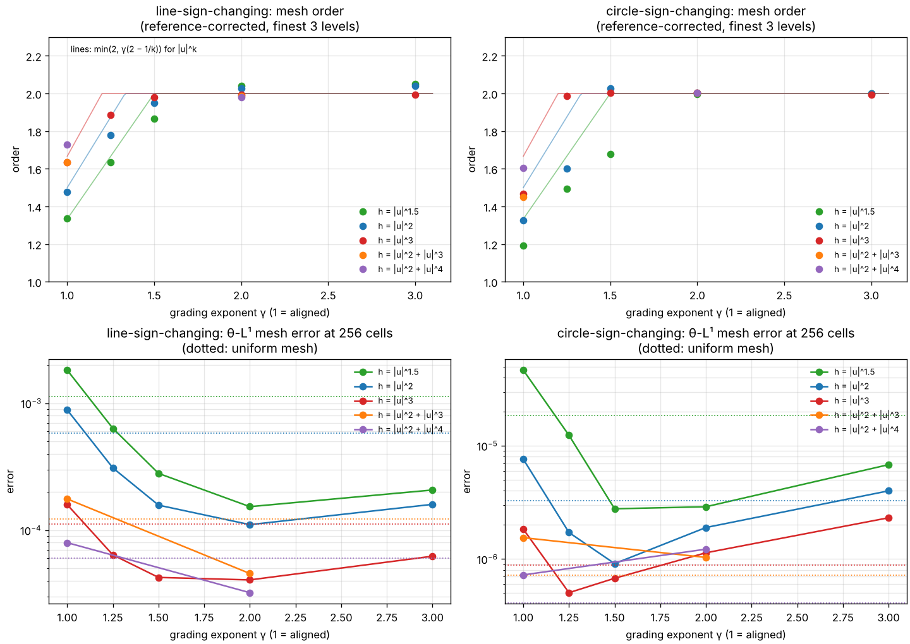

# Convergence on graded meshes (2026-11-07)

[The aligned-mesh report](convergence-2026-11-06.md) found mesh orders of
$2-1/k_{\max}$ near transverse zeros. It argued that power grading towards the
zeros should restore second order. This report tests that argument, together
with the sharper rate it predicts for every grading exponent. Graded meshes are
`PiecewiseAffine.aligned(..., grading=γ)` and, in the scripts,
`--mesh graded --grading γ`.

The findings in brief:

* **The predicted rate holds across the sweep.** For $\gamma\in\{1,1.25,1.5,2,3\}$
  the measured order follows $\min(2,\gamma(2-1/k_{\max}))$, after correcting for
  the finite reference.
* **At $\gamma=2$ every case is second order.** All ten combinations (two
  problems, five nonlinearities) give corrected orders between 1.98 and 2.02.
* **Grading is nearly free in events but not in the bulk constant.** Event
  counts stay within −14% and +26% of the aligned meshes. At γ = 2 the errors at
  256 cells fall below the uniform mesh's in seven of the ten cases, by up to 7×. They rise above it where the smooth
  $\Delta^2$ error dominated anyway, as on the circle for $u^2+u^4$. The most
  accurate γ sits a little above the threshold $2k_{\max}/(2k_{\max}-1)$.

These are observations against numerical references, not theorems.



## Graded meshes

Graded meshes keep the arcs and cell counts of the aligned mesh. Only the nodes
inside each arc that touches a zero move.

* **The map.** From a zero $z$ at one end of an arc of length $L$, uniform
  parameters $s_i=i/n$ map to $x_i=z+Ls_i^{\gamma}$.
* **Arcs between two zeros** use $2^{\gamma-1}s^{\gamma}$ on each half, mirrored,
  which is $C^1$ with slope $\gamma$ at the midpoint.
* **Cell lengths.** The cell touching a zero has length $L\,n^{-\gamma}$. Cell
  lengths then grow like $\Delta\,(d/L)^{1-1/\gamma}$ with the distance $d$. The
  largest cells, mid-arc, are about $\gamma$ times the aligned ones.
* **Nesting.** Refinement halves the $s$-grid, so the meshes stay nested.

## The predicted rate

A cell of length $\ell$ at distance $d\ge\ell$ from a transverse zero has
$|g-g_\Delta|=O(\ell^2)$ and relative error $O(\ell^2/d)$. The profile is
$|U|\sim d^{-1/k}$, with $k=k_{\max}$ the top degree of $h$. The cell's
contribution to the error is therefore about $\ell^3d^{-1-1/k}$.

With $\ell(d)\approx\Delta\,d^{\beta}$ and $\beta=1-1/\gamma$, the sum behaves like
$\Delta^2\int d^{2\beta-1-1/k}\,dd$. That integral converges at the zero exactly
when $\gamma>2k/(2k-1)$, and then the mesh error is $O(\Delta^2)$. Below the
threshold the cell touching the zero dominates: it has length $\ell_0\sim\Delta^{\gamma}$
and contributes $\ell_0^{2-1/k}$. Together:

$$\text{mesh order} \approx \min\bigl(2,\ \gamma(2-1/k)\bigr),$$

with a logarithmic factor at the threshold itself. $\gamma=1$ recovers the
aligned rate $2-1/k$. The thresholds are $3/2$ for $|u|^{3/2}$, $4/3$ for $u^2$,
$6/5$ for $|u|^3$ and $8/7$ for $u^4$. $\gamma=2$ exceeds all of them, since
$2k/(2k-1)<2$ for every $k>1$.

## Measured orders

Reference-corrected orders (`tools/fit_reference_order.py` on the finest three
levels), each followed by the prediction. The γ = 1 entries are the aligned
studies of 2026-11-06.

| Problem | $h$ | γ = 1 | γ = 1.25 | γ = 1.5 | γ = 2 | γ = 3 |
| --- | --- | --- | --- | --- | --- | --- |
| line | $\lvert u\rvert^{3/2}$ | 1.33 / 1.33 | 1.63 / 1.67 | 1.86 / 2† | 2.04 / 2 | 2.05 / 2 |
| line | $u^2$ | 1.48 / 1.50 | 1.78 / 1.88 | 1.95 / 2 | 2.03 / 2 | 2.04 / 2 |
| line | $\lvert u\rvert^3$ | 1.63 / 1.67 | 1.89 / 2 | 1.98 / 2 | 1.99 / 2 | 1.99 / 2 |
| line | $u^2+\lvert u\rvert^3$ | 1.64 / 1.67 | | | 1.99 / 2 | |
| line | $u^2+u^4$ | 1.73 / 1.75 | | | 1.98 / 2 | |
| circle | $\lvert u\rvert^{3/2}$ | 1.19 / 1.33 | 1.49 / 1.67 | 1.68 / 2† | 2.00 / 2 | 2.00 / 2 |
| circle | $u^2$ | 1.32 / 1.50 | 1.60 / 1.88 | 2.03 / 2 | 2.00 / 2 | 2.00 / 2 |
| circle | $\lvert u\rvert^3$ | 1.47 / 1.67 | 1.99 / 2 | 2.00 / 2 | 2.00 / 2 | 1.99 / 2 |
| circle | $u^2+\lvert u\rvert^3$ | 1.45 / 1.67 | | | 2.00 / 2 | |
| circle | $u^2+u^4$ | 1.61 / 1.75 | | | 2.00 / 2 | |

† γ equals the threshold $2k/(2k-1)$ for $k=3/2$, where a logarithmic loss is expected.

* **The line** follows the prediction within 0.1, except close to a threshold.
  The exceptions are † and $|u|^3$ at γ = 1.25, just above its threshold 1.2,
  and there the shortfall is 0.11–0.14.
* **The circle** reaches second order as soon as γ is clearly above the
  threshold. Below it, the circle shows the same shortfall it showed on aligned
  meshes. With grading the circle is second order from the coarsest level (local
  slopes 1.96–2.07 at γ = 2). So its slow approach on aligned meshes was the
  near-zero term itself, not a separate effect.
* **Top degree.** The general $h$ at γ = 2 behave exactly like the power laws.
  On aligned meshes their rate was set by the top degree; once that is above
  the grading threshold, it no longer matters.
* **Fit quality.** Over all five levels the γ = 2 fits have log residuals of
  0.2–1.6% (`fit_reference_order.py docs/data/convergence-2026-11-07/graded-g2`).

## Accuracy and cost

θ-L¹ mesh error at 256 cells:

| Problem | $h$ | uniform | aligned (γ = 1) | γ = 1.25 | γ = 1.5 | γ = 2 | γ = 3 |
| --- | --- | --- | --- | --- | --- | --- | --- |
| line | $\lvert u\rvert^{3/2}$ | 1.1e-3 | 1.8e-3 | 6.3e-4 | 2.8e-4 | **1.5e-4** | 2.1e-4 |
| line | $u^2$ | 5.8e-4 | 8.8e-4 | 3.1e-4 | 1.6e-4 | **1.1e-4** | 1.6e-4 |
| line | $\lvert u\rvert^3$ | 1.1e-4 | 1.6e-4 | 6.4e-5 | 4.3e-5 | **4.1e-5** | 6.2e-5 |
| line | $u^2+\lvert u\rvert^3$ | 1.2e-4 | 1.8e-4 | | | **4.6e-5** | |
| line | $u^2+u^4$ | 6.0e-5 | 8.0e-5 | | | **3.2e-5** | |
| circle | $\lvert u\rvert^{3/2}$ | 1.8e-5 | 4.7e-5 | 1.2e-5 | **2.8e-6** | 2.9e-6 | 6.8e-6 |
| circle | $u^2$ | 3.3e-6 | 7.6e-6 | 1.7e-6 | **9.1e-7** | 1.9e-6 | 4.0e-6 |
| circle | $\lvert u\rvert^3$ | 8.9e-7 | 1.8e-6 | **5.0e-7** | 6.8e-7 | 1.1e-6 | 2.3e-6 |
| circle | $u^2+\lvert u\rvert^3$ | **7.2e-7** | 1.5e-6 | | | 1.0e-6 | |
| circle | $u^2+u^4$ | **4.1e-7** | 7.2e-7 | | | 1.2e-6 | |

* **On the line** γ = 2 is best throughout: 1.9–7× below the uniform mesh and
  2.5–12× below the aligned one.
* **On the circle** the optimum is lower, γ = 1.25–1.5. That is just above each
  threshold: 1.5 for $|u|^{3/2}$ and $u^2$, 1.25 for $|u|^3$.
* **Where γ = 2 loses.** For $u^2+u^4$ on the circle, γ = 2 is 3× worse than
  uniform. The uniform mesh's error there was already dominated by the smooth
  $\Delta^2$ term (uniform slopes ≈ 2.0, near-zero term not yet visible).
  Grading only enlarges the mid-arc cells, by up to γ.
* **The trade-off.** Grading buys a better rate at the price of a larger bulk
  constant. The asymptotic winner is always the graded mesh, but at a fixed
  resolution the γ that gives the lowest error depends on which term dominates.

**Events** barely change. At 256 cells the graded runs need 0.86–0.98 times the
aligned events on the circle and 1.04–1.26 times on the line, the most at γ = 3
for $|u|^{3/2}$. Front tracking has no CFL condition. The tiny cells beside the
zeros therefore cost only the corner crossings of fronts that reach them, and
those fronts are absorbed soon after.

**Recommendation.** γ ≈ 2 is a safe default whenever accuracy near zeros matters.
It is second order for every admissible $h$. A γ just above $2k_{\max}/(2k_{\max}-1)$
is more accurate when $k_{\max}$ is known. The aligned default (γ = 1) remains the
right choice for reading off the near-zero rate itself.

A better graded mesh would grade only a layer of fixed width around each zero
and keep the bulk uniform. That would keep the second order without the
mid-arc penalty. It is not implemented.

## Reproduction

From the repository root. Each power-law grading takes a few minutes; the
general-h studies take 9–23 minutes each.

```bash
O=docs/data/convergence-2026-11-07
P="--problem line-sign-changing --problem circle-sign-changing"
C="--levels 5 --depth 2 --no-plot --max-events 5000000"
for g in 1.25 1.5 2 3; do
  python convergence.py --power 2 --power 1.5 --power 3 $P $C --mesh graded --grading $g --output $O/graded-g${g/./p}
done
python convergence.py --flux "u^2+u^4" --flux "u^2+|u|^3" $P $C --mesh graded --grading 2 --output $O/graded-g2
python tools/fit_reference_order.py $O/graded-g2
python tools/plot_grading.py $O docs/convergence-2026-11-07.png
```

`plot_grading.py` takes γ = 1 from the [aligned studies](data/convergence-2026-11-06/)
and the uniform baselines from the 2026-10-15, 2026-11-05 and 2026-11-06
records. Graded records carry `"mesh": "graded"` and `"grading": γ` in their
reference metadata. Logs are in [`logs/`](data/convergence-2026-11-07/logs/).

Validation at this commit: 150 unit and regression tests pass (5 optional oracle
tests skipped). The stress check and the example fingerprint are unchanged.
